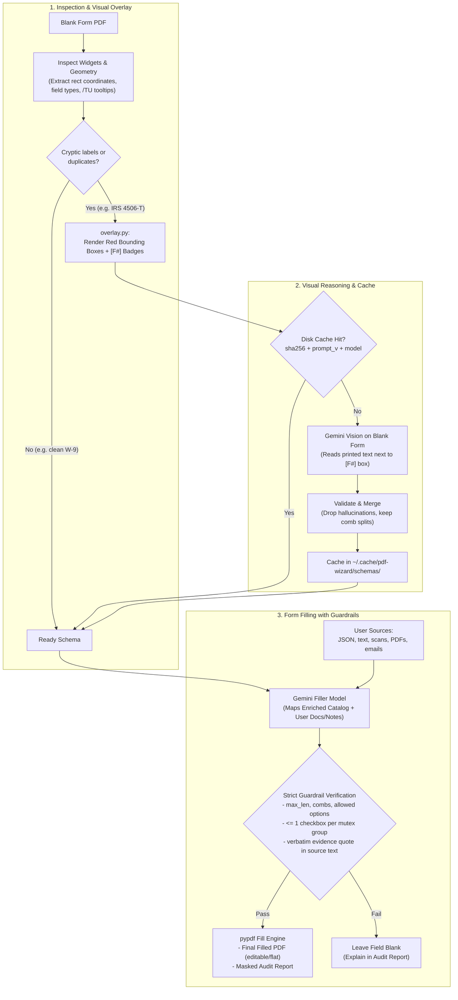

# PDF Wizard

PDF Wizard is a toolkit for **fillable (AcroForm) PDF forms**—such as tax forms (W-9, W-4, W-8BEN, 8822), clinic intake packets, and applications—supporting **two core workflows**:

1. **Use Case 1 — Fill PDF Forms from Your Documents & Data (`pdf-wizard`):** Automatically populate blank AcroForm PDFs from structured records (`JSON`/`CSV`), unstructured documents (scanned PDFs, smartphone photos, `.eml` emails, plain text), previously filled reference forms, and notes—with deterministic guardrails and verbatim evidence citations for every filled field.
2. **Use Case 2 — Generate Synthetic Form Data & Filled PDFs (`python -m evals.dataset`):** Synthesize 10s or 100s of realistic fake records, ground-truth filled PDFs, and matching unstructured source documents (`txt`, `scanned_pdf`, `jpeg`, `png`, `pdf`, `eml`) for built-in IRS/application forms (`Faker`, offline) or **any custom AcroForm PDF** (Gemini personas checked by the product guardrails; `--generator faker` works offline).

---

## Two Core Use Cases at a Glance

| Capability | Use Case 1: Filling Forms (`pdf-wizard`) | Use Case 2: Generating Form Data (`python -m evals.dataset`) |
|---|---|---|
| **Goal** | Fill a blank PDF form using your real or test documents | Generate synthetic filled PDFs + realistic source documents + ground truth |
| **Inputs** | Blank `.pdf` form + `--data`, `--doc`, `--reference`, `--note` | Blank `.pdf` form (`--template` or `--form`) + `--count` + `--formats` |
| **Outputs** | Filled PDF (`.pdf`) + masked audit report (`.json`) | `filled/*.pdf` (filled PDFs) + `cases/*/sources/*` + `expected.json` |
| **Requires Gemini / Cloud?** | Yes (`fill` and `schema --enrich`); `inspect` and deterministic `schema` run offline | Built-in templates: **no**. `--form`: yes by default (`--generator faker` is an offline fallback) |
| **Interfaces** | CLI (`pdf-wizard`), Web UI (`pdf-wizard serve`), Python API (`fill_form`) | CLI (`python -m evals.dataset`) and Python API (`generate_dataset`) |

---

## What problem it solves

Filling complex PDF forms automatically with an LLM usually fails in three ways:
1. **Opaque form structure:** Real-world PDFs often use cryptic internal field names (`f1_01[0]`, `c1_1[2]`), split a single number across multiple comb boxes (such as a 3-2-4 Social Security Number), or implement "check only one" groups as independent checkboxes.
2. **Silent hallucinations and derived guesses:** Without verification, an LLM may guess a value, compute an unstated field, or follow a prompt injection hidden inside an uploaded document.
3. **Formatting and rendering errors:** Writing an invalid option export value, exceeding a comb length, or breaking appearance streams corrupts the filled PDF.

PDF Wizard solves this by separating **Stage 1: Schema Detection** from **Stage 2: Evidence-Grounded Filling**, and enforcing deterministic **Guardrails** on every proposed value before writing to the PDF:

> **A blank field is better than a wrong one.**

Every value must cite a source and a verbatim quote (or JSON key path) that contains the value itself, fit the field's physical constraints, and meet the confidence threshold—otherwise the field is left blank and explained in the audit report.

## How it works



1. **Inspect & Detect Schema (Stage 1):** Reads the PDF's AcroForm widgets (type, options, max length, comb flags, format scripts), extracts tooltips and nearby printed labels, disambiguates split comb fields (SSN `3-2-4`, EIN `2-7`, phone `3-3-4`, ZIP+4 `5-4`), and groups mutually-exclusive checkboxes (`G1`, `G2`, ...).
2. **Visual Overlay & Schema Enrichment:** Government forms often lack descriptive tooltips or use cryptic internal keys like `topmostSubform[0].Page1[0].f1_07[0]`. In automatic mode, PDF Wizard renders a temporary overlay PDF with **red bounding boxes and bold `[F#]` badges** over the blank form. Gemini Vision inspects this overlay to visually associate each field with printed form headings, instructions, and checkbox matrix groups—**with zero user data or PII exposed**.
3. **Two-Tier Schema Cache:** Enriched schemas are cached in memory and on disk (`~/.cache/pdf-wizard/schemas/`, keyed by blank form `SHA-256`, prompt version, and model). Subsequent fills of the same form run instantly at $0 extra schema cost.
4. **Load Sources:** Normalizes structured JSON/CSV records, plain text, emails (`.eml`), scanned PDFs, JPEG/PNG images, previously filled reference PDFs, and user notes. Today's date is always provided as `S0`.
5. **Map (Stage 2):** One structured-output Gemini call proposes values for fields answered by the sources, citing `source_id` and a verbatim quote (or JSON key path) as `evidence`.
6. **Guardrails Engine:** Deterministically verifies every proposed value:
   - Fits the field's physical constraints (`max_len`, comb digits, allowed option values, format masks);
   - Respects mutually-exclusive checkbox groups (if multiple boxes in a group are proposed, all are rejected);
   - Blocks fields marked `office_use_only` or signature lines;
   - Verifies that `evidence` appears verbatim in the cited source and proves the proposed value;
   - Rejects prompt-injection text and proposals below the confidence threshold.
7. **Fill and Report:** Writes verified values with proper PDF appearances and outputs a JSON audit report with sensitive values (`SSN`, `EIN`, bank numbers, `DOB`) masked as `***-**-6789`.

---

## Installation

Requires **Python 3.12+**. For AI-powered form filling (`pdf-wizard fill`), also configure a Google Cloud project with Vertex AI enabled (or a paid-tier `GEMINI_API_KEY`).

```bash
python3 -m venv .venv
.venv/bin/pip install -r requirements-dev.lock
.venv/bin/pip install --no-deps -e .
```

---

## Use Case 1: Filling PDF Forms from Your Documents & Data

### 1. Inspect & Detect Schema (Local, No AI Needed)

```bash
# List a form's raw fields, types, flags, and options
.venv/bin/pdf-wizard inspect evals/cases/job_application/form.pdf
.venv/bin/pdf-wizard inspect evals/cases/job_application/form.pdf --json

# Stage 1: Detect and save a form's reusable schema (sections, comb splits, checkbox mutex groups)
.venv/bin/pdf-wizard schema evals/cases/irs_w9/form.pdf -o w9.schema.json

# Optional: Use Gemini on the blank form (zero user data) to visually enrich missing labels/groups
.venv/bin/pdf-wizard schema evals/cases/irs_w4/form.pdf --enrich -o w4.schema.json
```

### 2. Fill a Form via CLI (`pdf-wizard fill`)

```bash
# Authenticate with Vertex AI
gcloud auth application-default login
export GOOGLE_CLOUD_PROJECT=your-gcp-project-id

# Fill a W-9 from a scanned contractor document
.venv/bin/pdf-wizard fill evals/cases/irs_w9/form.pdf \
    --schema w9.schema.json \
    --doc evals/cases/irs_w9/sources/w9_contractor_scan.pdf \
    -o w9.filled.pdf \
    --report w9.report.json

# Fill a W-4 combining multiple documents (text + employer PDF memo)
.venv/bin/pdf-wizard fill evals/cases/irs_w4/form.pdf \
    --doc evals/cases/irs_w4/sources/w4_employee.txt \
    --doc evals/cases/irs_w4/sources/w4_employer_memo.pdf \
    -o w4.filled.pdf \
    --report w4.report.json

# Dry-run from structured JSON + a free-text note without writing a PDF
.venv/bin/pdf-wizard fill evals/cases/job_application/form.pdf \
    --data evals/cases/job_application/sources/applicant.json \
    --note "Can start November 2, 2026" \
    --dry-run
```

**Supported source flags (all repeatable):**
- `--data FILE` — structured `JSON` or `CSV` (use `--row N` to pick a 1-based record when a file contains multiple rows/records)
- `--doc FILE` — unstructured document: `PDF` (text or scanned), `PNG`, `JPEG`, plain text (`.txt`), or email (`.eml`)
- `--reference FILE` — a previously filled AcroForm PDF about the same person
- `--note TEXT` — a fact or instruction in your own words (e.g., `"Use my work address"`)

**Output & control flags:**
- `-o, --output FILE` — where to write the filled PDF
- `--report FILE` — write a JSON audit report (sensitive values masked)
- `--schema FILE` — reuse a pre-detected schema JSON (verified by `form_sha256`), skipping redundant visual blank-form uploads
- `--enrich-schema` / `--no-enrich-schema` — always / never run Stage 1 visual schema enrichment (default: automatic, only when labels look unreliable; one extra Gemini call per new form, then cached)
- `--flatten` — produce a non-editable PDF (by default, outputs remain editable)
- `--min-confidence X` — override `PDF_WIZARD_MIN_CONFIDENCE` for one run (`0.0`–`1.0`)
- `--dry-run` — map and verify values through guardrails without writing a PDF
- `--force` — allow overwriting existing output files (input files are never overwritten; outputs use `0600` owner-only permissions)
- `-q, --quiet` — print only the summary line
- Exit codes: `0` success, `2` invalid input, `3` unsupported form, `4` AI or configuration error

### 3. Fill Forms via the Local Web UI (`pdf-wizard serve`)

```bash
.venv/bin/pdf-wizard serve            # http://127.0.0.1:8000/, or --port N (1024-65535)
```

The terminal prints a one-time 256-bit sign-in token. Open `http://127.0.0.1:8000/`, paste the token, upload your form and sources, and download the filled PDF when the job completes. The results page shows every field with its status, masked value, source, and evidence.

- Listens on `127.0.0.1` only (single-user local tool). Sessions, jobs, and rate limits live in process memory.
- Sessions expire on sign-out, after 30 minutes idle, after 8 hours, or when the server stops.
- Use Chrome or Firefox (`Secure` cookies on `http://127.0.0.1` / `http://localhost` may not be accepted by Safari).
- **Loopback note:** Browsers share cookies across ports on `127.0.0.1` / `localhost`. Do not run untrusted local web servers while signed in, and sign out when finished.

### Reading the Fill Report

| Status | Meaning |
|---|---|
| `filled` | Verified by guardrails and written to the PDF |
| `no_data` | Nothing in your sources answered this field |
| `rejected` | A proposed value failed a guardrail check and the field was left blank (`invalid_value`, `unverified`, `low_confidence`, `unknown_source`, `render_failed`) |
| `not_writable` | Read-only, hidden, signature, or button fields, which are never filled |

Sensitive values look like `***-**-6789` in reports, and their evidence is replaced with `[hidden: sensitive]`.

---

## Use Case 2: Generating Synthetic Form Data & Filled PDFs

Need realistic test data, pre-filled sample PDFs, or a large-scale multimodal benchmark for a new form? The synthetic dataset generator (`python -m evals.dataset`) uses hand-written `Faker` templates for the built-in forms (offline) and Gemini personas for custom forms.

For every generated record `1..N`, it automatically produces:
1. **`<out>/filled/<id>.pdf`** — A ground-truth AcroForm PDF populated with realistic synthetic data (editable or flattened with `--flatten`).
2. **`<out>/cases/<id>/sources/*`** — A matching unstructured source document containing the same facts, rendered in your chosen modality (`txt`, `scanned_pdf`, `jpeg`, `png`, `pdf`, or `eml`).
3. **`<out>/cases/<id>/`** — A self-contained evaluation case (`form.pdf`, `case.json`, `expected.json`) ready to score with `python -m evals.run`.
4. **`<out>/manifest.json`** — Dataset metadata (seed, templates, formats, sample IDs).

### Generate Synthetic Data for Built-in Forms

Built-in templates: `irs_w9`, `irs_w4`, `irs_8822`, `irs_w8ben`, `job_application`, or `all`.

```bash
# Generate 100 synthetic filled PDFs + multimodal sources across all 5 built-in templates
.venv/bin/python -m evals.dataset --template all --count 100 --out /tmp/synth_100

# Generate 200 synthetic W-9 filled PDFs with only scanned PDF and JPEG image sources
.venv/bin/python -m evals.dataset \
    --template irs_w9 \
    --count 200 \
    --formats scanned_pdf,jpeg \
    --out /tmp/w9_scans
```

### Generate Synthetic Data for Any Custom AcroForm PDF

Pass `--form path/to/your_form.pdf`. The generator reads the form's field catalog and asks Gemini for coherent fictional personas: values plus, for each value, the sentence of the intake document that states it. Every persona then goes through the **same guardrails as the filler** (type, options, `max_len`, comb, format mask, one checkbox per group, and the value must be stated by its sentence); failing values are dropped from both the document and `expected.json`. Raw personas are saved to `cases/<id>/persona.json`, and `--reuse-personas` rebuilds cases from them without calling Gemini.

To reduce model-grading-itself bias, use a different generator model than the filler (`--generator-model` or `PDF_WIZARD_GENERATOR_MODEL`; a warning is printed if they match), and keep a hand-reviewed golden set (`evals/golden/`, see its `REVIEW.md`).

```bash
.venv/bin/python -m evals.dataset \
    --form path/to/custom_form.pdf \
    --count 50 \
    --formats txt,scanned_pdf,jpeg,png,pdf,eml \
    --seed 42 \
    --generator-model <other-model-id> \
    --out /tmp/custom_dataset
```

### Generator CLI Options (`python -m evals.dataset`)

| Flag | Default | Description |
|---|---|---|
| `--template` | `all` | Built-in template: `irs_w9`, `irs_w4`, `irs_8822`, `irs_w8ben`, `job_application`, or `all` |
| `--form FILE` | `None` | Path to any custom AcroForm PDF (overrides `--template` and synthesizes from its detected schema) |
| `-n, --count N` | `20` | Number of synthetic records / filled PDFs to generate |
| `--formats LIST` | `txt,scanned_pdf,jpeg,png,pdf,eml` | Comma-separated source document modalities to cycle through |
| `-o, --out DIR` | (required) | Output directory for `filled/*.pdf`, `cases/*`, and `manifest.json` |
| `--seed N` | `42` | Random seed for deterministic, reproducible generation |
| `--flatten` | `False` | Flatten generated PDFs in `filled/*.pdf` into non-editable documents |
| `--copy-form` | `False` | Copy `form.pdf` into each case folder instead of hardlinking/symlinking |
| `--generator` | `gemini` | `--form` only: `gemini` personas, or `faker` (offline; generic values, for smoke tests) |
| `--generator-model ID` | `$PDF_WIZARD_GENERATOR_MODEL`, else the filler model | `--form` only: model that writes personas |
| `--reuse-personas` | `False` | `--form` only: rebuild cases from existing `cases/*/persona.json` without model calls |

### Benchmark Models Against Checked-in or Generated Datasets

See [`evals/README.md`](evals/README.md) for full details on scoring precision, recall, and hallucination rate:

```bash
# Run the 8 checked-in benchmark cases (4 synthetic stress cases + 4 official IRS forms)
.venv/bin/python -m evals.run --model gemini-3.8-flash

# Run against a custom synthetic dataset generated by evals.dataset
.venv/bin/python -m evals.run --cases /tmp/synth_100/cases --model gemini-3.8-flash
```

---

## Configuration

| Variable | Default | Meaning |
|---|---|---|
| `GOOGLE_CLOUD_PROJECT` | (required for Vertex) | Google Cloud project ID for Vertex AI |
| `GOOGLE_CLOUD_LOCATION` | `global` | Vertex AI region (for example `global` or `us-central1`) |
| `PDF_WIZARD_BACKEND` | `vertex` | `vertex`, or `gemini-api` with `GEMINI_API_KEY` (paid tier only) |
| `PDF_WIZARD_MODEL` | `gemini-3.8-flash` | Gemini model ID; benchmark candidates with `python -m evals.run` |
| `PDF_WIZARD_MIN_CONFIDENCE` | `0.7` | Minimum confidence required to fill a field from verifiable sources |
| `PDF_WIZARD_MIN_CONFIDENCE_UNVERIFIABLE` | `0.85` | Minimum confidence for image/scanned sources without a text layer |
| `PDF_WIZARD_TEMPERATURE` | model default | Sampling temperature (`0.0`–`2.0`) |
| `PDF_WIZARD_TIMEOUT_S` | `180` | Timeout per model request in seconds (`10`–`900`) |
| `PDF_WIZARD_LOG_LEVEL` | `WARNING` | Log level; logs never contain field values or document text |
| `PDF_WIZARD_SCHEMA_CACHE` | `1` | `0` disables the on-disk cache of enriched schemas |
| `PDF_WIZARD_SCHEMA_CACHE_DIR` | `$XDG_CACHE_HOME/pdf-wizard/schemas` | Where enriched schemas (labels only, no values) are cached (`0700` dir, `0600` files) |
| `PDF_WIZARD_GENERATOR_MODEL` | filler model | Default `--generator-model` for `evals.dataset --form` |

## Privacy and security

- **Where data goes:** your documents and form are sent only to Gemini in your configured Google Cloud project (or paid-tier Gemini API). Nothing else leaves your machine. Built-in-template data generation (`evals.dataset --template`), `pdf-wizard inspect`, and deterministic `pdf-wizard schema` make zero network calls. Schema enrichment sends only the blank form.
- **Zero-PII logs & masked reports:** logs record only IDs, counts, timings, and error types with a redaction filter as a safety net. Reports and the web UI mask sensitive values.
- **Untrusted files:** content-based file type verification, strict byte/page/field caps (`10 MB` per file, `20 MB` total, `100` pages, `1,000` fields), and no JavaScript execution. Document text and form labels are treated strictly as untrusted data.

## Limitations

- Fills AcroForm PDFs with fillable widgets. XFA-only forms and flat/scanned PDFs cannot be filled as target forms (they can still be used as input `--doc` sources).
- Signature fields are never filled, and filling a signed PDF invalidates its signature.
- Multi-select choice fields are filled with a single value.
- Always review the filled PDF and report before submitting an official form.

## Development & Forking

```bash
# Run the full offline test suite (920+ unit, security, schema, and end-to-end tests)
.venv/bin/pytest

# Regenerate the synthetic eval cases in evals/cases/
.venv/bin/python -m evals.make_cases

# Audit locked dependencies for known CVEs
.venv/bin/pip-audit -r requirements-dev.lock --disable-pip --no-deps
```

### Project layout

```
src/pdf_wizard/
    cli.py          CLI entry point (`inspect`, `schema`, `fill`, `serve`)
    pipeline.py     Two-stage orchestration (`inspect_form`, `detect_form_schema`, `fill_form`)
    schema.py       Stage 1 schema detection, comb disambiguation, mutex grouping, LRU cache
    guardrails.py   Deterministic verification of values, formats, mutex groups, and evidence
    evidence.py     Verbatim quote and structured key-path grounding checks
    privacy.py      Sensitive field detection and masking for reports and UI
    models.py       Pydantic data models (`FormField`, `FormSchema`, `FillReport`, ...)
    config.py       Environment configuration and resource limits
    errors.py       User-safe exception hierarchy and exit codes
    report.py       Report construction and masking
    logsafe.py      PII-redacting log filter
    pdf/            AcroForm inspection (`inspector.py`), filling & flattening (`filler.py`)
    sources/        Normalizers for JSON/CSV, text, `.eml`, PDFs, images, reference forms, notes
    mapping/        Prompt construction (`prompt.py`), `GeminiMapper` (`gemini.py`), `FakeMapper` (`fake.py`)
    web/            Local FastAPI web UI, session/CSRF/CSP security middleware, in-memory job runner
evals/
    harness.py      Case loader, validator, and precision/recall/hallucination scorer
    run.py          Live model & threshold benchmark CLI (`python -m evals.run`)
    dataset.py      Synthetic PDF & multimodal eval dataset generator (`python -m evals.dataset`)
    personas.py     Gemini persona generator + guardrail validation for custom forms
    golden/         One case per real form, pending human review (see REVIEW.md)
    make_cases.py   Generator for the synthetic cases in `evals/cases/`
    cases/          8 benchmark cases (4 synthetic + 4 official IRS forms: W-9, W-4, 8822, W-8BEN)
tests/              Offline pytest suites + programmatic PDF generator (`pdf_factory.py`)
```

## License

Licensed under the [Apache License 2.0](LICENSE).
